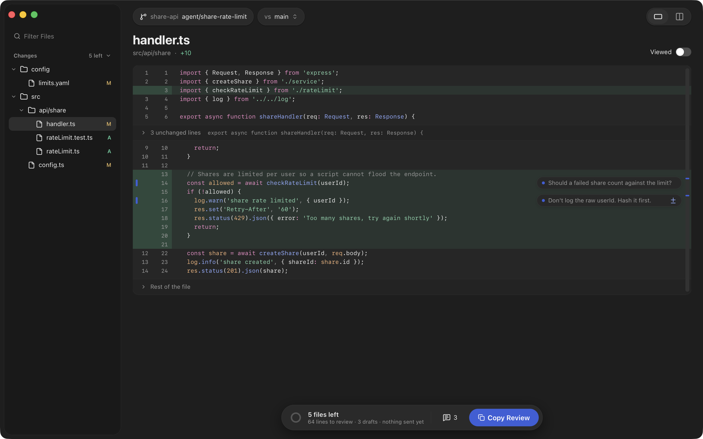
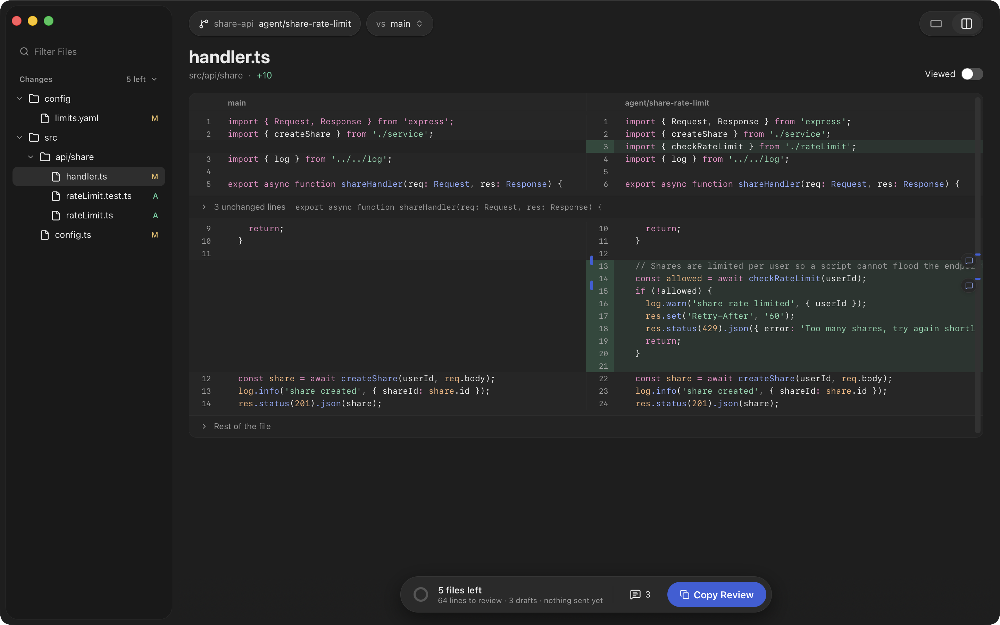
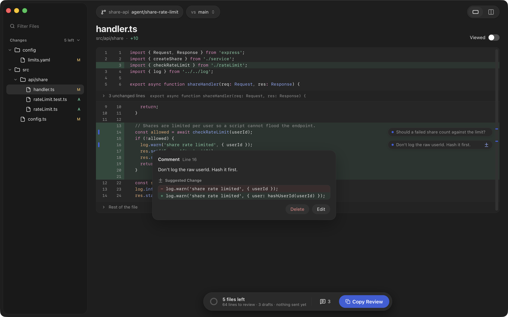
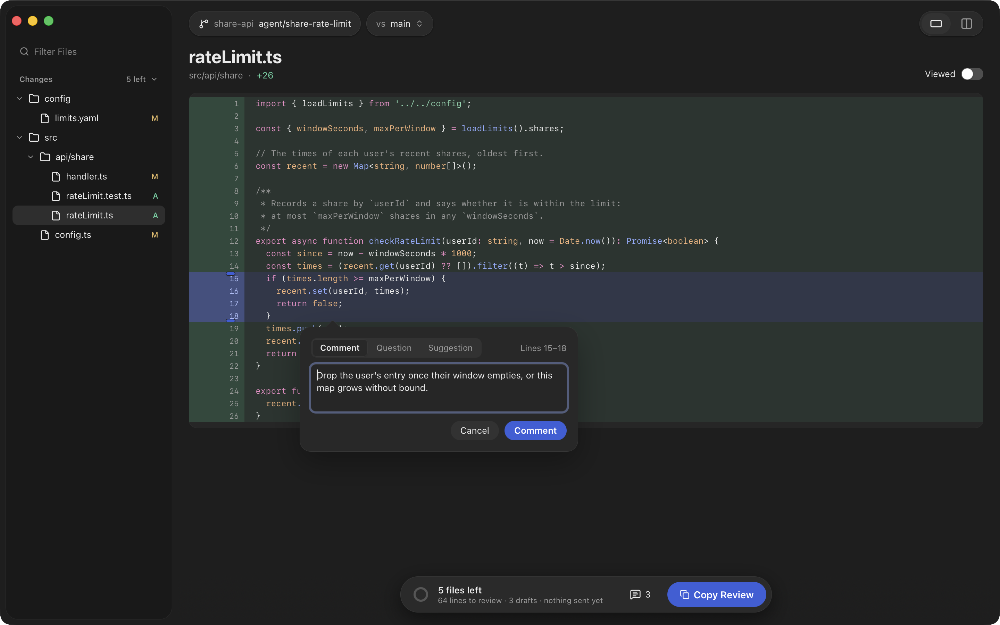
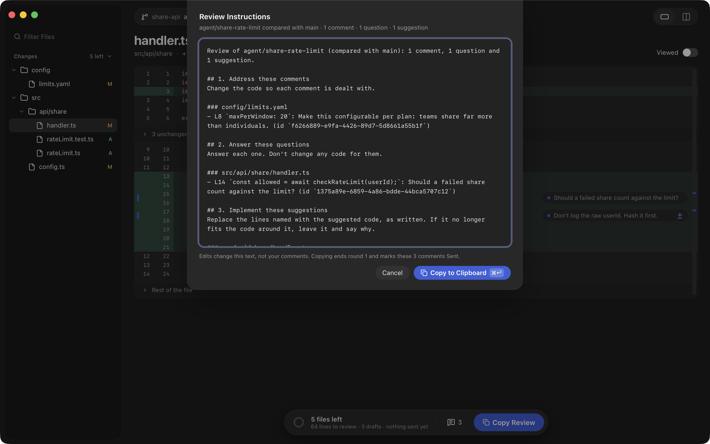
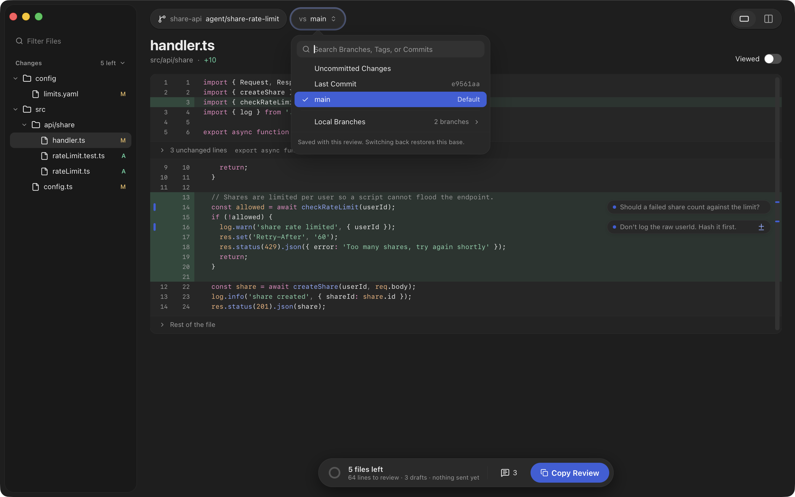
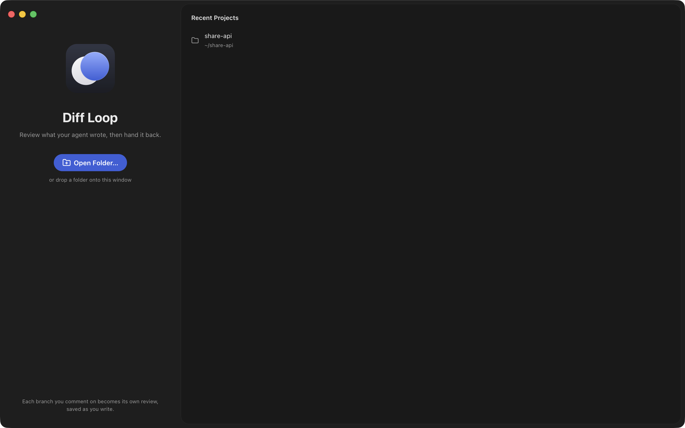

<p align="center">
  
</p>

<h1 align="center">Diff Loop</h1>

<p align="center">Review what your agent wrote, then hand it back.</p>

<p align="center">
  <a href="LICENSE"></a>
</p>

Diff Loop is a desktop app for reviewing what a coding agent changed. It
keeps one review per branch and shows that branch's diff live from
whichever worktree has it checked out, or from its commits when none
does. You comment on lines, ranges or whole files, then copy the
comments as Markdown instructions to paste into the agent's session. It
has a Rust core and a React 19 and TypeScript front end in a
[Tauri 2](https://tauri.app) shell.



## How it works

1. **Open a project.** Open a folder, drop one on the window, or pick one
   of the 8 most recent projects on the welcome screen. Diff Loop shows
   what the branch changed compared with a base: any branch, tag or
   commit, or only the uncommitted changes, or only the last commit. It
   follows the files as the agent edits them. ⌘/Ctrl-K switches to
   another branch of the project, without checking anything out.
2. **Comment.** Click a line's number, or drag down the numbers for a
   range. In the composer, pick Comment for a change to make, Question
   for something the agent should answer without changing code, or
   Suggestion for the code you want in the lines' place.
3. **Copy the review and paste it into your agent.** The instructions
   name the review file and each comment's id.
4. **The agent resolves what it dealt with**, through the MCP server or
   by editing the review file, with a note saying what it changed or
   answering the question. The window shows each one as resolved by the
   agent, or a question as "Answered by agent", with its note.
5. **You have the last word.** Press R to accept, or edit the comment to
   reopen it. What is still open goes out again under "Still open" with
   the next copy.

## Gallery

| | |
|---|---|
|  |  |
| The diff side by side, with ⌘/Ctrl-2. | A suggestion: the code you want in the lines' place. |
|  |  |
| The composer, with Comment, Question and Suggestion. | The instructions, previewed before you copy them. |
|  |  |
| The base picker: a branch, a tag, a commit, or the uncommitted changes. | The welcome screen, with the most recent projects. |

## What you paste into your agent

````text
Review of agent/share-rate-limit (compared with main): 1 comment, 1 question and 1 suggestion.

## 1. Address these comments
Change the code so each comment is dealt with.

### config/limits.yaml
- L5 `maxPerWindow: 20`: Make this configurable per plan. (id `a2d7f419-…`)

## 2. Answer these questions
Answer each one. Don't change any code for them.

### src/api/share/handler.ts
- L9 `const limit = await checkShareLimit(userId);`: Should a failed share count against the limit? (id `e41b7c03-…`)

## 3. Implement these suggestions
Replace the lines named with the suggested code, as written. If it no longer fits the code around it, leave it and say why.

### src/api/share/handler.ts
- L12 `log.warn('share rate limited', { userId });`: Don't log the raw userId. Hash it first. (id `c94d0e57-…`)
  ```ts
  log.warn('share rate limited', { user: hashUserId(userId) });
  ```

## When you're done
These are kept in `/Users/you/code/drive-web/.git/diff-loop/reviews/agent%2Fshare-rate-limit.json`. Mark each one you dealt with resolved, with a one-line note saying what you changed or giving your answer: call `resolve_comment` on the `diff-loop` MCP server with its id and the note, or, without it, set its `"resolved"` to `"byAgent"` and its `"note"` to the note in that file, changing nothing else. Leave anything you did not do as it is.
````

## Install

Each release on the Releases page carries an Apple Silicon `.dmg`,
`Diff.Loop_<version>_aarch64.dmg`. It is ad-hoc signed, not signed with
an Apple Developer ID, and not notarized. There is no build for Intel
Macs or Windows, and no updater: download and install each new version
by hand.

**macOS.** Open the `.dmg` and drag Diff Loop to Applications. macOS
refuses to open it the first time: choose **Open Anyway** in System
Settings › Privacy & Security, or clear the quarantine flag once:

```sh
xattr -dr com.apple.quarantine "/Applications/Diff Loop.app"
```

**Linux.** Build from source (see below), unless a release lists Linux
files. A release built by the Release workflow carries
`Diff.Loop_<version>_amd64.AppImage`, for any x86-64 Linux, and
`Diff.Loop_<version>_amd64.deb`, for Debian and Ubuntu. 0.9.0 to 0.11.0
carry only the `.dmg`.

- AppImage: make it executable and run it. It needs FUSE 2
  (`pacman -S fuse2` on Arch, `libfuse2` on Debian and Ubuntu).

  ```sh
  chmod +x Diff.Loop_*_amd64.AppImage
  ./Diff.Loop_*_amd64.AppImage
  ```

- `.deb`: `sudo apt install ./Diff.Loop_*_amd64.deb`, then open Diff
  Loop from the app launcher.

## Connect your agent

The copied instructions are what reaches the agent: an MCP server cannot
write into the agent's session, so you paste them in. They name the
review file, so an agent can mark what it dealt with without any setup.
With the `diff-loop` MCP server it does so through `get_review` and
`resolve_comment` instead. The server is not in the installers yet;
build it from source:

```sh
cargo build --release -p diff-loop-mcp
```

Then register `target/release/diff-loop-mcp` with your agent. Claude Code:

```sh
claude mcp add diff-loop -- /path/to/diff-loop/target/release/diff-loop-mcp
```

Codex:

```sh
codex mcp add diff-loop -- /path/to/diff-loop/target/release/diff-loop-mcp
```

The server reads the review of the branch checked out where it starts,
so start the agent in the repository you are reviewing. The agent must be
on a branch: on a detached `HEAD` the server returns an error, since only
a branch has a review.

## Keyboard shortcuts

Letters, arrows and Return act when no text field is focused.

| Keys | Does |
|---|---|
| J / K, or ] / [ | Next / previous file |
| Shift-J / Shift-K | Next / previous file not viewed |
| V | Mark the file viewed, or not |
| N / P | Next / previous comment |
| ↓ / ↑ | Move the line cursor |
| Shift-↓ / Shift-↑ | Extend the range |
| Alt-↓ / Alt-↑ (Option) | Next / previous change |
| C, or Return | Comment on the cursor or range |
| E | Edit the open comment |
| R | Resolve the open comment, or accept what the agent resolved |
| ⌘/Ctrl-Backspace | Delete the open comment, with Undo |
| ⌘/Ctrl-Z | Undo the last delete |
| Shift-X | Show every unchanged line of the file |
| ⌘/Ctrl-1 / ⌘/Ctrl-2 | Unified / Split |
| ⌘/Ctrl-Shift-B | Open the base picker |
| ⌘/Ctrl-K | Open the branch switcher |
| ⌘/Ctrl-Shift-P | Preview the instructions |
| ⌘/Ctrl-Shift-C | Copy Review |
| ⌘/Ctrl-R | Check for changes now |
| ⌘/Ctrl-F | Find in the file |
| ⌘/Ctrl-O | Open a folder |
| ⌘/Ctrl-Shift-W | Close the folder |

## Where reviews are kept

Each branch's review is one file in its project's git directory, shared
by all its worktrees: `<common git dir>/diff-loop/reviews/<branch>.json`,
with `/` in a branch's name written `%2F`. Nothing else is written into a
repository. `projects.json` in the app's data directory lists the
projects that hold a review.

## Build from source

You need:

- Rust through [rustup](https://rustup.rs); `rust-toolchain.toml` pins
  the version, and rustup installs it.
- Node 22 with npm.
- `git`.
- Tauri 2's [system prerequisites](https://tauri.app/start/prerequisites/).
  On Debian and Ubuntu, `.github/workflows/ci.yml` lists the packages.
- On macOS, Xcode 26 for a release build: the Liquid Glass icon is
  compiled with Xcode's `actool`, which the Command Line Tools alone
  lack.

```sh
cd app
npm install
npm run tauri dev
npm run tauri dev -- -- -- ~/code/my-repo   # open a repository on launch
```

`npm run tauri dev` shows the flat icon in the Dock; the glass one is
seen in a built bundle. A built binary opens the folder given as its
first argument: `diff-loop-app <path>`.

## Architecture

| Crate | Path | Role |
|---|---|---|
| `diff-loop-core` | `crates/core` | Domain and its ports, `Repository`, `Project` and `ReviewStore`; no I/O |
| `diff-loop-git` | `crates/git` | `Repository` and `Project` over the `git` command line |
| `diff-loop-app` | `app/src-tauri` | Composition root and Tauri commands |
| `diff-loop-mcp` | `crates/mcp` | MCP server on stdio: an agent reads a branch's review and resolves comments |
| `diff-loop-store` | `crates/store` | `ReviewStore` as a file per branch in each project's git directory |
| `diff-loop-review` | `crates/review` | The review loop's commit gate; dev-only |

The core depends on no Tauri crate and no other workspace crate. The
front end is in `app/src`. Each crate has a spec in `docs/spec/`, and
decisions are recorded in `docs/adr/`.

## Contributing

See [CONTRIBUTING.md](CONTRIBUTING.md).

## License

[MIT](LICENSE), copyright Diff Loop authors.
