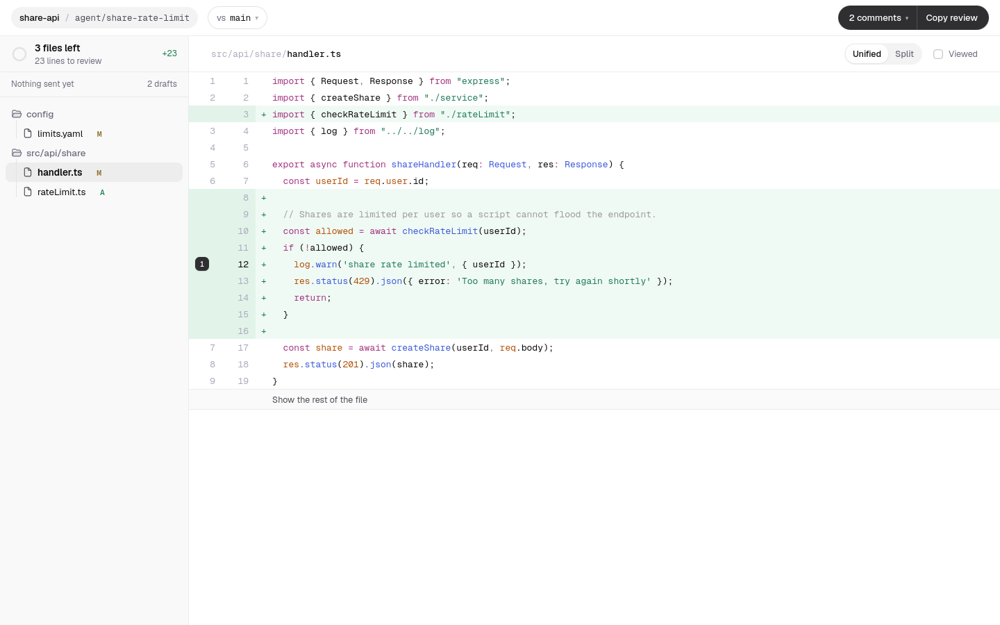

<p align="center">
  
</p>

<h1 align="center">Diff Loop</h1>

<p align="center">Review what your agent wrote, then hand it back.</p>

<p align="center">
  
  <a href="LICENSE"></a>
</p>



Diff Loop is a desktop app for reviewing what a coding agent changed. It
shows the diff for whatever branch or worktree is checked out, takes
comments on lines, ranges or whole files, with suggested code if you like,
and copies them as instructions to paste into the agent's session. It has
a Rust core and a [Tauri](https://tauri.app) front end.

## How it works

1. **Open a repository.** Diff Loop shows what the checked-out branch
   changed compared with a base branch, or only the uncommitted changes,
   or only the last commit. It follows the files as the agent edits them.
2. **Comment.** Click a line's number or drag down the numbers, write
   what should change, and add suggested code if you have it.
3. **Copy the review and paste it into your agent.** When it has made its
   changes, the next round shows each comment you sent as untouched,
   changed, removed or applied. Resolve the ones that are done; the rest
   go out again under "Still open".

## What you paste into your agent

````text
Please address these review comments on agent/share-rate-limit (compared with main).

### config/limits.yaml
- L5 `maxPerWindow: 20`: Make this configurable per plan.

### src/api/share/handler.ts
- L12 `log.warn('share rate limited', { userId });`: Don't log the raw userId. Hash it first.
  Suggested change:
  ```ts
  log.warn('share rate limited', { user: hashUserId(userId) });
  ```

When done, reply with one line per comment saying what you changed.
````

## Install

Each release on this repository's Releases page carries:

| File | For |
|---|---|
| `Diff.Loop_<version>_amd64.AppImage` | Any x86-64 Linux, Arch included |
| `Diff.Loop_<version>_amd64.deb` | Debian and Ubuntu |
| `Diff.Loop_<version>_aarch64.dmg` | Macs with Apple Silicon |

The repository is private, so downloading needs access to it.

**Linux, AppImage.** Make it executable and run it; it needs FUSE 2
(`pacman -S fuse2` on Arch, `libfuse2` on Debian and Ubuntu):

```sh
chmod +x Diff.Loop_*_amd64.AppImage
./Diff.Loop_*_amd64.AppImage
```

**Debian and Ubuntu.** `sudo apt install ./Diff.Loop_*_amd64.deb`, then
open Diff Loop from the app launcher.

**macOS.** Open the `.dmg` and drag Diff Loop to Applications. The app is
not signed with an Apple Developer ID yet, so macOS refuses to open it the
first time: choose **Open Anyway** in System Settings › Privacy & Security,
or clear the quarantine flag once:

```sh
xattr -dr com.apple.quarantine "/Applications/Diff Loop.app"
```

## Release

Set the new version in `app/src-tauri/tauri.conf.json`,
`app/src-tauri/Cargo.toml` and `app/package.json` (then `cargo check` and
`npm install` update the lockfiles), commit, and push a tag `v<version>`.
The Release workflow refuses a tag that does not match
`tauri.conf.json`, builds the installers above and attaches them to a
draft release; publish it once the files are checked.

## Run from source

Needs Rust 1.99, Node 22 with npm, `git`, and Tauri's
[system dependencies](https://tauri.app/start/prerequisites/).

```sh
cd app
npm install
npm run tauri dev
npm run tauri dev -- -- -- ~/code/my-repo   # open a repository on launch
```

`cargo test --workspace` runs the Rust tests and regenerates the
TypeScript bindings in `app/src/bindings/`.

## License

[MIT](LICENSE)
